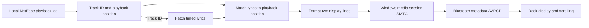

# DeskLyric

[简体中文](README.md) · **English**

DeskLyric shows lyrics for the track playing in the NetEase Cloud Music Windows client on the Xiaomi Smart Band multifunction desktop dock. It runs in the Windows system tray and uses the dock's built-in smooth scrolling. Your music can keep playing through your headphones or usual speakers.

**Instruction**: Completed using vibe coding, with most of the work done by <u>Chatgpt</u>. Before using this software, the SMTC setting in the NetEase Cloud Music settings needs to be turned off in advance. Otherwise, only the song title and artist will be displayed. If it cannot be used after turning off, please restart. 

**Reason**: When playing NetEase Cloud Music on the PC (as I mainly use NetEase Cloud Music, other music software has not been tested), the Xiaomi bracelet table-attached robot was unable to display. Later, it was discovered that the NetEase Cloud Music v3 version already natively supports SMTC, enabling the push display of the singer and song title. After testing it with the BetterNCM and InfLink-rs plugins on NetEase Cloud Music, the table-attached robot could only display the song title and artist, lacking the lyrics display like when connected to a mobile phone. This inspired me to complete this project. It can achieve Bluetooth connection with the table-attached device, and when the output device is selected as headphones or other output devices, the bracelet can display the lyrics, eliminating the need to turn on the lyrics display on the PC desktop. It can be regarded as adding an extra function of viewing lyrics to this useless table-attached device.

## Contents

- [Photos](#photos)
- [Features and display modes](#features-and-display-modes)
- [Download and setup](#download-and-setup)
- [How it works](#how-it-works)
- [Troubleshooting](#troubleshooting)
- [Build from source](#build-from-source)
- [Project structure](#project-structure)
- [Credits](#credits)

## Photos

| Track title and artist | Scrolling lyrics |
| :---: | :---: |
|  |  |

## Features and display modes

- Follows track changes, pauses, playback resumes, and seeks in NetEase Cloud Music.
- Supports the dock's built-in smooth scrolling and static pages that advance with playback.
- Handles Chinese, English, and mixed-language text. Shows the track title and artist during intros, while loading lyrics, or when timed lyrics are unavailable.
- Supports automatic following, manual start and stop from the system tray, and launch at sign-in. Display preferences are saved across restarts.

Choose **歌词显示 → 平滑滚动（设备原生）** (Lyric display → Native smooth scrolling), then pick a layout in **第二行内容** (Second line).

| Second-line setting | First line | Second line |
| --- | --- | --- |
| Next lyric, both lines scroll | Current lyric | Next lyric. Either line can scroll when it exceeds the display width. |
| Next lyric, static preview | Current lyric, scrolling when needed | Next lyric, shortened by estimated display width and held still |
| Track title and artist | Current lyric, scrolling when needed | Track title and artist |

In **静态分页** (Static paging) mode, DeskLyric splits the current lyric into short pages and advances them with playback.

## Download and setup

The release targets x64 PCs running Windows 10 version 2004 or later and bundles the .NET 8 runtime. Install the NetEase Cloud Music Windows client and keep an internet connection available for lyric retrieval. DeskLyric runs independently of BetterNCM and InfLink-rs.

1. Open **Releases** in the GitHub repository and download `DeskLyric-v1.0.0-win-x64.exe` from the `v1.0.0` assets.
2. Extract it to a folder you can write to. Connect the dock over Bluetooth and check that it appears in the Windows audio output list.
3. Run `DeskLyric.exe` and start playing a track in NetEase Cloud Music. The DeskLyric icon may be in the taskbar's hidden icons area.
4. Right-click the tray icon and use **歌词显示** (Lyric display) and **第二行内容** (Second line) to choose a layout.

## How it works



1. **Track playback.** DeskLyric reads new entries from `%LOCALAPPDATA%\NetEase\CloudMusic\cloudmusic.elog` and extracts the track ID, playback state, and position changes. These events anchor the playback clock. DeskLyric fetches LRC lyrics by track ID and uses the timestamps to find the current and next lines.
2. **Format both lines.** Native scrolling uses a conservative combined budget of 120 UTF-8 bytes. When both lines scroll, each gets 60 bytes and longer text is displayed in segments. The static preview estimates screen width with a similar font and reserves room for an ellipsis. Transfer size and rendered width are calculated separately.
3. **Let the dock scroll the text.** DeskLyric publishes both lines as the title and artist in a Windows media session and routes a quiet carrier audio track to the dock. Windows sends the metadata over Bluetooth AVRCP, and the dock firmware renders and scrolls the text. NetEase Cloud Music keeps using its own audio output.

## Troubleshooting

The tested combination was NetEase Cloud Music `3.1.42.205594`, Xiaomi Smart Band 9, and dock firmware `3.0.3_0179.0064`.

| Symptom | What to check |
| --- | --- |
| Waiting for playback activity | Switch tracks in NetEase Cloud Music. If its log is in a different location, quit DeskLyric and set `NeteaseLogPath` in `config.json` beside the executable. |
| Long text is clipped or ends in an ellipsis | Check that **平滑滚动（设备原生）** (Native smooth scrolling) is selected. In static preview mode, the second line is deliberately shortened and held still. |
| Long lines stay still in native mode | Check that Windows lists a speaker whose name includes `小米手环多功能桌搭`. Use **打开日志** (Open log) from the tray and look for `carrier routed to` to see where the carrier audio went. |
| The last lyric stays on screen after stopping | DeskLyric ends the push. The dock may hold the previous metadata temporarily, and its firmware determines when the face returns. |

When reporting an issue, include your Windows, NetEase Cloud Music, and dock firmware versions and the selected display mode. Check `desklyric.log` for track names or lyrics before sharing it publicly.

## Build from source

Install the .NET 8 SDK on Windows and run the following command from the repository root.

```powershell
dotnet publish .\DeskLyric.csproj -c Release -r win-x64 --self-contained true -p:DebugType=None -p:DebugSymbols=false -o .\publish
```

The executable is written to `publish/DeskLyric.exe`.

## Project structure

| Path | Responsibility |
| --- | --- |
| [Core/](Core/) | NetEase log decoding, playback clock, and text budget |
| [LyricEngine.cs](LyricEngine.cs) | Lyric retrieval, timestamp matching, two-line layout, carrier routing, and media session updates |
| [PreviewFontMetrics.cs](PreviewFontMetrics.cs) | Display-width estimation for the static second line |
| [Program.cs](Program.cs) and [Config.cs](Config.cs) | Tray controls, player process monitoring, and saved preferences |
| [Tests/](Tests/) | Core logic and Windows media session tests |

## Credits

NetEase log parsing draws on the Jingge project and its upstream log decoder. [dsh-pet-qqmusic](https://github.com/344272586-sketch/dsh-pet-qqmusic) · [netease-cloudmusic-detector-py](https://github.com/YouRanCoder/netease-cloudmusic-detector-py)

Thanks to the plugin used when first exploring media metadata display on the dock. [InfLink-rs](https://github.com/apoint123/inflink-rs)

